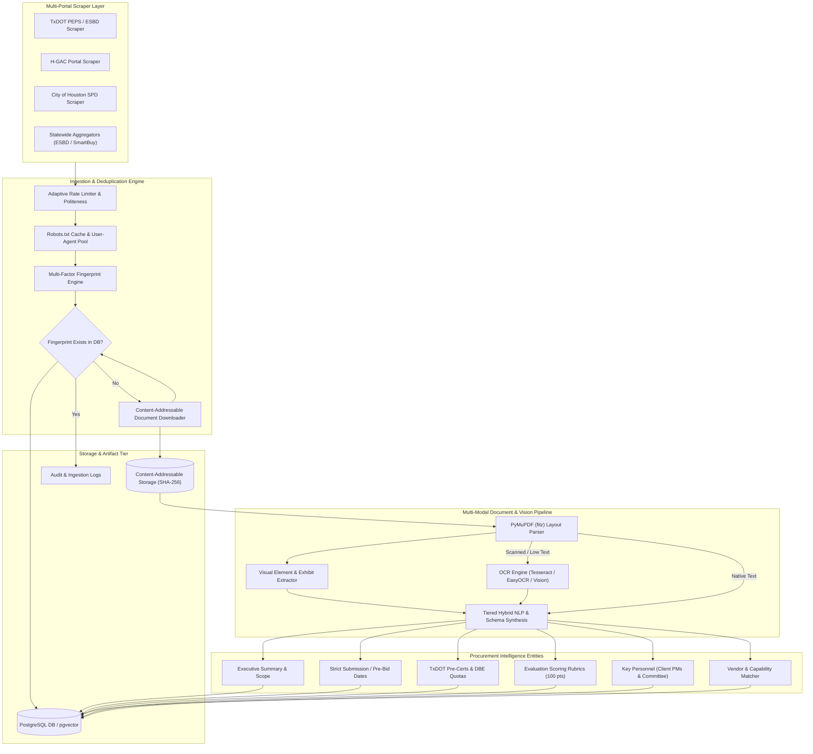
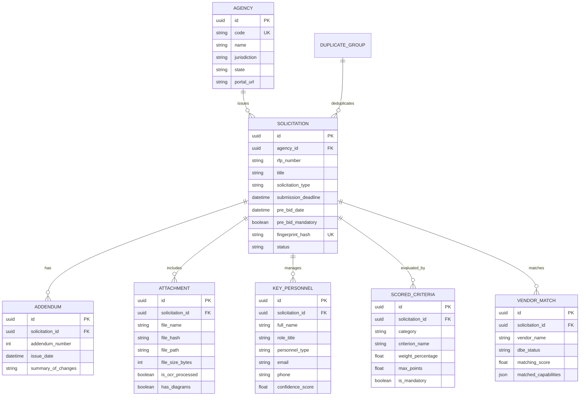

# Intelligent Procurement Platform (IPP) System Architecture

## 1. Executive Summary & Purpose

The Intelligent Procurement Platform (IPP) is a high-throughput, multi-agency procurement intelligence and forecasting pipeline designed to discover, ingest, normalize, and analyze public-sector procurement solicitations (Requests for Proposals - RFPs, Requests for Qualifications - RFQs, and Invitations for Bids - IFBs). 

The platform focuses on Intelligent Transportation Systems (ITS), traffic management, civil infrastructure, connected vehicle systems, and municipal technology contracts. The primary focus region centers on the Texas and Southeastern corridor, with initial production validation across three core target authorities:
1. **TxDOT (Texas Department of Transportation)**: Professional Engineering Procurement Services (PEPS) and Electronic State Business Daily (ESBD).
2. **H-GAC (Houston-Galveston Area Council)**: Regional Council of Governments (COG) and Metropolitan Planning Organization (MPO) solicitations, cooperative purchasing, and regional ITS deployments.
3. **City of Houston**: Strategic Procurement Division (SPD) and Houston Public Works (HPW) contracting portals.

IPP solves three industry-wide bottlenecks:
- **Scattered Discovery & Duplication**: Aggregator portals (e.g., Texas SmartBuy/ESBD, GovWin, DemandStar) and agency direct portals duplicate listings with differing titles, formatting, and deadlines. IPP employs deterministic and fuzzy multi-factor fingerprinting to deduplicate records into canonical opportunity entities.
- **Unstructured Multi-Modal PDF Bundles**: Public RFPs contain complex attachments, addenda, scanned amendments, engineering schematics, and evaluation matrices. IPP utilizes a tiered hybrid processing pipeline (PyMuPDF layout parsing paired with computer vision and OCR) to extract structured deadlines, DBE/HUB quotas, pre-certifications, and scoring rubrics.
- **Decision-Maker Blindness**: Selection committees and client project managers (PMs) determine bid outcomes. IPP automates the extraction and tracking of agency decision-makers and key personnel to enable proactive relationship mapping.

---

## 2. High-Level System Architecture



---

## 3. Multi-Portal Scraper Layer

The scraping architecture is built on an extensible `BaseScraper` contract prioritizing reliability, anti-blocking hygiene, and deterministic identity assignment.

### 3.1 Portal Adapters
1. **TxDOT PEPS Scraper (`txdot_scraper.py`)**:
   - Monitors TxDOT Professional Engineering Procurement Services procurement calendar, active RFPs/RFQs, and waiver solicitations.
   - Parses engineering project classifications: ITS system design, traffic signal synchronization, highway reconstruction, environmental impact, and schematic development.
   - Extracts solicitation package numbers (e.g., `601CT0000005820`), pre-certification categories (e.g., standard TxDOT codes `3.2.1 Route Studies`, `4.2.1 Major Roadway Design`, `8.1.1 Signing and Pavement Markings`, `11.1.1 Roadway Construction Management`), and DBE participation percentages.
2. **H-GAC Scraper**:
   - Ingests regional cooperative contracts, transportation planning consulting, and high-capacity corridor feasibility RFPs.
   - Normalizes MPO transportation improvement programs (TIP) and Council of Governments committee minutes.
3. **City of Houston Strategic Procurement Division (SPD)**:
   - Polls e-Procurement solicitations for Houston Public Works (HPW), Houston Information Technology Services (HITS), and Houston Airport System (HAS).
   - Tracks formal sealed bids, RFPs for municipal smart traffic infrastructure, and MWBE/DBE subcontracting goals.

### 3.2 Politeness, Resilience & Anti-Bot Strategy
- **Rate Limiting with Exponential Jitter**: Requests enforce a base inter-request latency (default 1.5s - 3.0s) parameterized with random Gaussian jitter to eliminate detectable robotic cadence.
- **Robots.txt Enforcement & In-Memory Cache**: Scrapers verify URI permissions against host `robots.txt` endpoints with a 24-hour in-memory TTL cache.
- **Transient Failure Retries**: Network flakiness, HTTP 429 (Too Many Requests), and HTTP 5xx errors trigger an exponential backoff retry loop (factors 2, 4, 8 seconds) up to 4 attempts before surfacing an alert.
- **Headless Browser Fallback**: For SPA portals (e.g., modern Bonfire or BuySpeed frontends), Playwright provides JavaScript rendering with explicit selector barriers (`networkidle` triggers).

### 3.3 Deduplication & Fingerprinting Engine
A primary hazard in multi-portal scraping is ingesting the same opportunity repeatedly from statewide portals (e.g., TxDOT mirrored on ESBD) or regional mirrors.

The platform computes a **Deterministic Opportunity Fingerprint** using canonical hashing:
```
NormalizedString = (
    CleanAgencyCode + "|" +
    StripPunctuation(CanonicalRfpNumber) + "|" +
    NormalizeTitle(OpportunityTitle) + "|" +
    ISODate(SubmissionDeadline)
)
FingerprintHash = SHA256(NormalizedString)
```

- **Fuzzy Deduplication**: When RFP numbers are missing or portal-specific, secondary similarity comparison evaluates Levenshtein distance on normalized titles coupled with deadline proximity (within a ±24-hour window).
- **Canonical Opportunity Clustering**: Solicitations recognized as duplicates are linked to a single `DuplicateGroup` record in PostgreSQL. The canonical record preserves the earliest discovery timestamp, aggregates all attachment mirrors, and logs cross-portal source URLs.

---

## 4. Document Storage & Artifact Tier

Federal, state, and municipal procurement regulations require provenance citations. The IPP pipeline stores all downloaded documents and exhibits locally and in object storage before processing.

### 4.1 Content-Addressable Storage Layout
Every document (RFP PDF, addendum, spec sheet, engineering drawing, pre-bid sign-in sheet) is hashed with SHA-256 upon stream ingestion.

```
storage/
└── sources/
    └── {agency_code}/
        └── {solicitation_id}/
            ├── attachments/
            │   ├── {sha256_hash}.pdf
            │   └── {sha256_hash}.docx
            ├── addenda/
            │   └── addendum_1_{sha256_hash}.pdf
            ├── exhibits/
            │   ├── exhibit_diagram_p12_01.png
            │   └── exhibit_table_p18_01.json
            └── manifest.json
```

### 4.2 Storage Capacity & Hardware Bounds
Reflecting the platform hardware estimates from `Research Nodes/2025-12-20 Cursor Procurement Platform Hardware Estimate.md`:
- **Document Volume**: 240+ regional agencies $\times$ 50-200 solicitations/year $\times$ 2.5 MB average PDF size = **240 GB to 500 GB per year** of raw procurement artifacts.
- **3-Year Storage Target**: 5-7 TB uncompressed object storage, scaling to 10-14 TB with local mirrors and off-site backup snapshots.
- **Node Topology**:
  - *Development / Local Node*: 8-core CPU (16 threads), 32 GB RAM (16 GB operational minimum), 500 GB system SSD + 2 TB dedicated document NVMe storage, optional 8 GB VRAM NVIDIA GPU.
  - *Production Cluster*: Application server (16 cores, 64 GB RAM), dedicated Database server (16 cores, 128 GB RAM, 5-10 TB NVMe), and dedicated GPU inference worker (NVIDIA RTX 4090 / A100 for multi-modal OCR and embeddings).

---

## 5. Multi-Modal OCR & Computer Vision Pipeline

Procurement documents frequently consist of hundreds of pages combining native vector text, scanned addenda pages, organizational charts, intersection schematics, project timelines, and complex evaluation criteria matrices.

```mermaid
flowchart LR
    INPUT_PDF["Input Solicitation PDF"] --> TIER1_FIT["PyMuPDF (fitz) Stream Inspection"]
    TIER1_FIT --> TEXT_CHECK{"Is Text Density >= 80%?"}

    TEXT_CHECK -- Yes (Native PDF) --> LAYOUT_PARSE["Layout & Block Hierarchy Extraction"]
    TEXT_CHECK -- No (Scanned Image) --> PREPROC["Image Preprocessing: Denoise, Deskew, CLAHE"]
    PREPROC --> OCR_ENG["OCR Engine (Tesseract / EasyOCR)"]
    OCR_ENG --> LAYOUT_PARSE

    LAYOUT_PARSE --> EXHIBIT_DET["Visual Element & Exhibit Detector"]
    EXHIBIT_DET --> EXTRACT_TABLES["Table & Matrix Structure Recovery"]
    EXHIBIT_DET --> EXTRACT_DIAGRAMS["Diagram & Architecture Image Crop"]

    LAYOUT_PARSE --> LLM_SYNTH["Tier-2 Reasoning: Gemini / Gemma Agentic Tier"]
    EXTRACT_TABLES --> LLM_SYNTH
    EXTRACT_DIAGRAMS --> LLM_SYNTH

    LLM_SYNTH --> STRUCTURED_JSON["Structured Opportunity Schema"]
```



### 5.1 Hybrid Tiered AI Pipeline
Per `Research Nodes/2025-08-17 Hybrid Tiered AI for Procurement Documents.md`, IPP adopts a two-tier hybrid processing strategy:
- **Tier 1 (High-Speed Local Triage)**:
  - `PyMuPDF (fitz)` extracts text blocks, bounding boxes, font attributes, and embedded graphics at sub-second speeds.
  - Fast regular expression and spatial heuristics classify documents (Main RFP, Addendum, Wage Rate Schedule, Cost Template, Exhibit) and isolate key sections.
  - Pages with low text density (< 80 characters per page) are routed to computer vision pre-processing (denoising, CLAHE contrast enhancement, deskew) and multi-engine OCR.
- **Tier 2 (Deep Semantic Reasoning & Extraction)**:
  - Extracted text blocks and isolated tables are fed to Tier-2 LLMs (Gemini API / local `gemma4-12b-agentic` on Node A).
  - Handles nuanced context: disambiguating conflicting addenda dates, resolving ambiguous point weights, and standardizing diverse organizational roles into canonical personnel models.

### 5.2 Visual Exhibit & Diagram Extraction
- **Table & Scoring Rubric Detection**: Morphological line detection and PyMuPDF vector drawing operators detect bordered evaluation matrices, submittal checklists, and pricing spreadsheets.
- **Schematic & Exhibit Extraction**: Detects engineering drawings (intersection ITS cameras, fiber optic trunk routes, variable message sign locations) embedded in RFP appendices. Saves high-resolution cropped PNGs linked to the solicitation record for engineering team review.

---

## 6. Key Decision-Maker & Personnel Intelligence

A key differentiator of IPP is mapping human stakeholders behind each RFP:
- **Client Project Manager (PM)**: The technical owner who writes the specifications and oversees proposal evaluation.
- **Selection Committee / Review Panelists**: Evaluators scoring the technical submittals.
- **Procurement & Contracting Officers**: Official points of contact for administrative questions and formal letters of clarification.

### 6.1 Extraction Heuristics
1. **RFP Administrative Section Parsing**: Regex and NER scan headings such as *"Procurement Officer"*, *"Points of Contact"*, *"Project Manager"*, *"Inquiries Regarding This Solicitation"*, *"Pre-Proposal Conference Host"*.
2. **Contact Validation & Normalization**:
   - Extraction of full name, job title, institutional email (`@txdot.gov`, `@houstontx.gov`, `@h-gac.com`), telephone number, and physical office/district.
   - Confidence scoring ($0.0$ to $1.0$) based on context proximity, valid domain patterns, and cross-reference with agency staff directories.
3. **Relationship Mapping**:
   - Connects `KeyPersonnel` to historical solicitations, enabling institutional memory: *"Which vendors won previous ITS contracts evaluated by this Project Manager?"*

---

## 7. Data Models & Entity Relationships

The data layer is modeled using both **Pydantic v2 schemas** (for runtime parsing, validation, and API serialization) and **SQLAlchemy 2.0 ORM** (for relational persistence in PostgreSQL).



---

## 8. Requirements & Evaluation Scoring Engine

The RFP parsing engine extracts critical operational requirements to produce structured, actionable pursuit profiles:

1. **Submission Deadlines & Milestones**:
   - `submission_deadline`: Hard cut-off timestamp (strictly parsed with timezone detection).
   - `pre_bid_date`: Pre-proposal conference timestamp with `pre_bid_mandatory` flag.
   - `qa_deadline`: Final date for submitting vendor questions.
2. **Pre-Certifications & Compliance Requirements**:
   - Standard transportation engineering categories (e.g., TxDOT PEPS Work Codes: `3.2.1 Route Studies`, `4.2.1 Major Roadway Design`, `8.1.1 Traffic Control Systems`, `11.1.1 Construction Management`).
   - Professional licensing prerequisites: Professional Engineer (PE), Registered Professional Land Surveyor (RPLS), American Institute of Certified Planners (AICP).
   - Disadvantaged Business Enterprise (DBE) / Historically Underutilized Business (HUB) subcontracting participation targets (e.g., 12.5% DBE goal).
3. **Scored Criteria & Weights**:
   - Normalization of evaluation factors into structured records:
     - `Project Approach & Technical Understanding` (e.g., 30 pts)
     - `Project Manager & Key Personnel Qualifications` (e.g., 25 pts)
     - `Firm Prior Experience & Reference Projects` (e.g., 20 pts)
     - `Cost / Pricing Proposal` (e.g., 15 pts)
     - `DBE/HUB Subcontracting Plan` (e.g., 10 pts)
   - Built-in validation rule ensuring total weights sum to 100 points/percent.

---

## 9. Technology Stack & Implementation Directory

| Component | Technology | Rationale |
| :--- | :--- | :--- |
| **Language** | Python 3.9+ | Core data science, scraping, and typing ecosystem |
| **Data Validation** | Pydantic v2 | High-performance schema validation, serialization |
| **Relational ORM** | SQLAlchemy 2.0 | Async-ready ORM, cross-database (PostgreSQL + SQLite) |
| **PDF Extraction** | PyMuPDF (fitz) | Fast native C++ PDF stream inspection, bbox layout, visual drawing detection |
| **Computer Vision** | OpenCV + PIL | Adaptive image preprocessing, table grid detection, deskewing |
| **OCR Engines** | Tesseract / EasyOCR | Fallback transcription for scanned image exhibits |
| **Web Scraping** | Requests + Playwright | Requests for static portals; Playwright for dynamic JS portals |
| **Testing** | pytest | Automated unit and integration testing suite |

### Directory Scaffold
```
work/projects/procurement/
├── architecture.md               # Complete System Architecture & Engineering Spec
├── models.py                     # Pydantic v2 & SQLAlchemy 2.0 Data Models
├── scrapers/
│   ├── __init__.py
│   ├── base_scraper.py           # Resilient Base Scraper (Rate Limiter, Fingerprinting, Downloader)
│   └── txdot_scraper.py          # TxDOT PEPS & ESBD Solicitation Scraper
├── processor/
│   ├── __init__.py
│   └── rfp_parser.py             # PyMuPDF + OCR Parser (Executive Summary, Deadlines, Scoring, PM)
└── tests/
    ├── __init__.py
    └── test_procurement_models.py# Unit Tests for Validation, Deduplication & RFP Extraction
```
